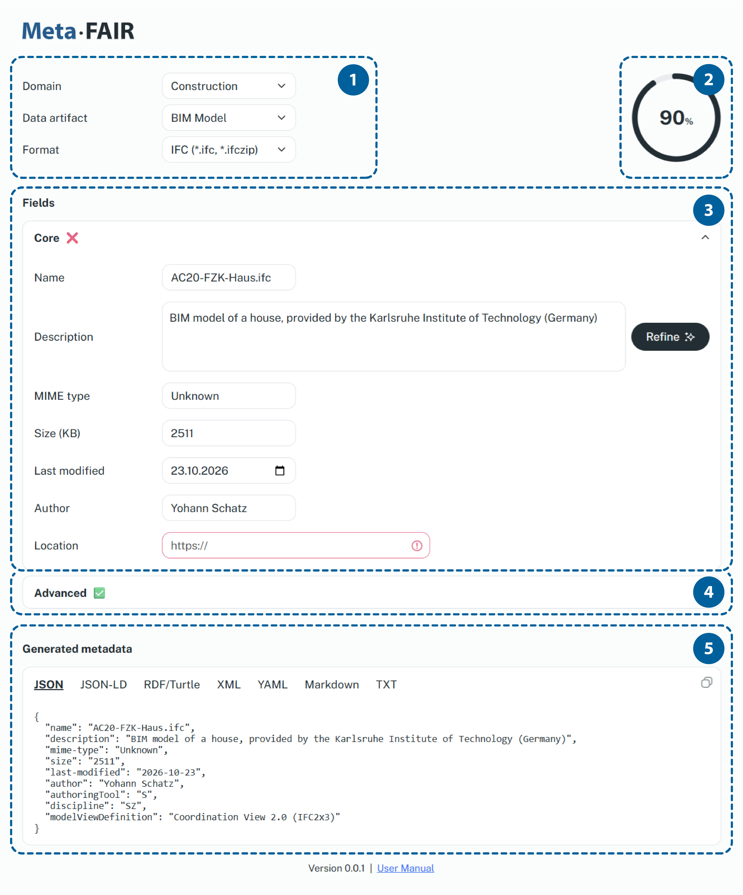

# MetaFAIR

MetaFAIR est un projet visant à faciliter la création de métadonnées détaillées et contextualisées pour les artefacts de données produits dans le cadre de la recherche scientifique. Il repose sur deux livrables complémentaires :

- **Une ontologie**, qui formalise les concepts et les relations nécessaires à la description des artefacts, de leurs formats et des champs de métadonnées associés. Sa structure modulaire est conçue pour pouvoir être étendue à de nouveaux domaines scientifiques.
- **Une application web**, qui exploite cette ontologie pour proposer un formulaire adapté au domaine, au type d’artefact et au format de données sélectionnés, accompagner la saisie et générer les métadonnées dans différents formats.

Le prototype a été développé en prenant comme premier domaine d’application celui de la construction. L’architecture vise toutefois à permettre l’intégration progressive d’autres domaines et types de ressources.

------------------------------------------------------------------------

# 1. Ontologie

L’ontologie MetaFAIR décrit les artefacts de données, les formats de fichiers et les champs de métadonnées qui peuvent leur être associés. Elle constitue le modèle de connaissances exploité par l’application pour déterminer les informations à demander à l’utilisateur.

**Accès aux fichiers de l’ontologie :**  <https://github.com/y-schatz/metafair-public/tree/main/ontologies>

## 1.1. Description

L’ontologie est répartie en plusieurs fichiers OWL, chacun ayant une responsabilité spécifique. Cette organisation modulaire distingue les concepts communs des définitions propres aux domaines, aux formats et aux champs.

| Fichier                    | Rôle                                                                                                                                                                                                                                                                                                   |
|:---------------------------|:-------------------------------------------------------------------------------------------------------------------------------------------------------------------------------------------------------------------------------------------------------------------------------------------------------|
| `core.owl`                 | Définit les concepts fondamentaux de l’ontologie, notamment `DataArtifact`, `DataFormat` et `Field`, ainsi que les propriétés qui permettent de les relier. Il définit également plusieurs propriétés de données communes, comme `creationDate`, `description`, `identifier`, `location` et `version`. |
| `fields.owl`               | Décrit les champs de métadonnées disponibles et les informations nécessaires à leur définition, notamment leur type (`fieldType`) et, pour les champs à choix, leurs valeurs possibles (`enumeratedValue`).                                                                                            |
| `formats.owl`              | Répertorie les formats de données pris en charge, leurs extensions de fichiers et, le cas échéant, les champs spécifiques associés à un format.                                                                                                                                                        |
| `artifacts/construction.owl` | Contient les types d’artefacts propres au domaine de la construction et leurs associations avec les formats et les champs pertinents.                                                                                                                                                                  |

Les dépendances entre les fichiers sont organisées autour de `core.owl` :

- `fields.owl` importe `core.owl`, car les champs sont définis comme des individus de type `core:Field`.
- `formats.owl` importe `core.owl` et `fields.owl`, afin de déclarer les formats et de leur associer des champs.
- `artifacts/construction.owl` importe `core.owl`, `fields.owl` et `formats.owl`, afin de définir les artefacts du domaine et leurs relations avec les formats et les champs.

Cette organisation permet de séparer les éléments génériques des éléments propres à un domaine. Pour ajouter un domaine, il est ainsi possible de créer un module dédié sans devoir redéfinir les concepts fondamentaux.

### Principales relations

Deux propriétés jouent un rôle central dans l’association des artefacts, des formats et des champs :

- `core:hasFormat` associe un artefact à un ou plusieurs formats de données.
- `core:hasField` associe des champs de métadonnées à un artefact ou à un format.

Les champs associés directement à un artefact décrivent ses caractéristiques propres. Les champs associés à un format décrivent des informations liées à la structure ou aux spécificités techniques de ce format. L’application peut ainsi réunir les champs pertinents à partir du type d’artefact et du format sélectionnés.

Par exemple, dans le module actuel consacré à la construction, l’individu `BIMModel` est associé au format `IndustryFoundationClasses` (IFC) et aux champs `AuthoringTool` et `Discipline`. Le format IFC est lui-même associé au champ `ModelViewDefinition`.

## 1.2. Extension de l’ontologie

L’ontologie est conçue pour être enrichie progressivement. Les exemples ci-dessous illustrent les principales opérations d’extension.

Les extraits sont des modèles indicatifs en syntaxe Turtle. Les préfixes doivent être déclarés dans le fichier concerné et les identifiants doivent être adaptés au module créé. Les exemples supposent que les propriétés et les classes du noyau sont celles définies dans `core.owl`.

### Ajouter un nouveau domaine

Un domaine est représenté par un module OWL distinct, qui importe les ontologies communes nécessaires. Il regroupe les types d’artefacts propres à ce domaine et leurs associations avec les formats et les champs.

Par exemple, pour ajouter le domaine *ExampleDomain*, créer sous `artifacts/` un fichier `example-domain.owl` et y déclarer l’ontologie ainsi que ses imports :

##### `artifacts/example-domain.owl`
``` turtle
@prefix : <http://www.hesge.ch/metafair/ontologies/artifacts/example-domain#> .
@prefix owl: <http://www.w3.org/2002/07/owl#> .
@prefix core: <http://www.hesge.ch/metafair/ontologies/core#> .
@prefix rdfs: <http://www.w3.org/2000/01/rdf-schema#> .

<http://www.hesge.ch/metafair/ontologies/artifacts/example-domain>
    a owl:Ontology ;
    owl:imports
        <https://raw.githubusercontent.com/y-schatz/metafair/refs/heads/main/ontologies/core.owl> ,
        <https://raw.githubusercontent.com/y-schatz/metafair/refs/heads/main/ontologies/fields.owl> ,
        <https://raw.githubusercontent.com/y-schatz/metafair/refs/heads/main/ontologies/formats.owl> .
```

Le nouveau module doit ensuite être rendu accessible à l’application et ajouté à la configuration ou au mécanisme de découverte des domaines utilisé par celle-ci. La déclaration d’un fichier OWL ne suffit pas, à elle seule, à le faire apparaître dans l’interface si l’application ne le charge pas.

### Ajouter un nouveau type d’artefact

Un type d’artefact est représenté par un individu de la classe `core:DataArtifact`. Il peut être associé à un format au moyen de `core:hasFormat` et à des champs de métadonnées au moyen de `core:hasField`.

Exemple : déclaration d’un artefact fictif `ExampleArtifact` :

##### `artifacts/example-domain.owl`

``` turtle
...

:ExampleArtifact
    a owl:NamedIndividual, core:DataArtifact ;
    rdfs:label "Example artifact"@en ;
    core:hasFormat formats:ExampleFormat ;
    core:hasField fields:ExampleArtifactField .
```

Les identifiants `formats:ExampleFormat` et `fields:ExampleArtifactField` doivent correspondre à des éléments effectivement définis dans les ontologies importées ou dans le module concerné.

### Ajouter un nouveau format de données

Un format est représenté par un individu de la classe `core:DataFormat`. Son extension de fichier est renseignée au moyen de `core:fileExtension`. Des champs spécifiques peuvent lui être associés avec `core:hasField`.

Exemple : ajout d’un format fictif `ExampleFormat` :

##### `formats.owl`

``` turtle
@prefix : <http://www.hesge.ch/metafair/ontologies/formats#> .
@prefix core: <http://www.hesge.ch/metafair/ontologies/core#> .
@prefix fields: <http://www.hesge.ch/metafair/ontologies/fields#> .
@prefix owl: <http://www.w3.org/2002/07/owl#> .
@prefix rdfs: <http://www.w3.org/2000/01/rdf-schema#> .

:ExampleFormat
    a owl:NamedIndividual, core:DataFormat ;
    rdfs:label "Example format"@en ;
    core:fileExtension "*.jdf" ;
    core:hasField fields:ExampleFormatField .
```

L’extension `*.jdf` est illustrative. Elle doit être remplacée par l’extension réellement utilisée. L’association à un champ est facultative : elle n’est nécessaire que si le format requiert des métadonnées spécifiques.

### Ajouter un nouveau champ de métadonnées

Un champ est représenté par un individu de la classe `core:Field`. Sa propriété `core:fieldType` indique le type de contrôle que l’application doit utiliser pour permettre la saisie. Une étiquette lisible est définie avec `rdfs:label`.

Exemple : ajout d’un champ fictif `ExampleField` :

##### `fields.owl`

``` turtle
@prefix : <http://www.hesge.ch/metafair/ontologies/fields#> .
@prefix core: <http://www.hesge.ch/metafair/ontologies/core#> .
@prefix owl: <http://www.w3.org/2002/07/owl#> .
@prefix rdfs: <http://www.w3.org/2000/01/rdf-schema#> .

:ExampleField
    a owl:NamedIndividual, core:Field ;
    core:fieldType "text" ;
    rdfs:label "Example field"@en .
```

Pour un champ de type `select`, les valeurs proposées sont définies au moyen de `core:enumeratedValue` :

``` turtle
:ExampleChoiceField
    a owl:NamedIndividual, core:Field ;
    core:fieldType "select" ;
    core:enumeratedValue "Value A", "Value B", "Value C" ;
    rdfs:label "Example choice"@en .
```

#### Types de champs pris en charge

Les types ci-dessous correspondent aux valeurs de `core:fieldType` prévues par le modèle de l’application.

| Type      | Description                                                                               | Exemple de déclaration             |
|:----------|:------------------------------------------------------------------------------------------|:------------------------------|
| `boolean` | Valeur booléenne (vrai ou faux).                                                          | `true`                        |
| `date`    | Date.                                                                                     | `2026-10-23`                  |
| `url`     | Adresse web.                                                                              | `https://example.org`         |
| `number`  | Valeur numérique.                                                                         | `42`                          |
| `select`  | Choix parmi une liste de valeurs définies avec `core:enumeratedValue`.                    | `Value A`                     |
| `text`    | Texte libre.                                                                              | `Description de la ressource` |
| `label`   | Champ de type étiquette ou valeur textuelle courte, selon le comportement de l’interface. | `Example`                    |

Les exemples de valeurs sont indicatifs. Le type déclaré dans l’ontologie doit correspondre au type de donnée attendu par l’application.

### Associer un champ à un artefact ou à un format

Un champ peut être associé directement à un type d’artefact ou à un format de données. Cette distinction permet de définir des métadonnées générales pour une catégorie de ressources et des métadonnées complémentaires propres à un format.

**1. Associer un champ à un type d’artefact**

Dans cet exemple, `ExampleArtifactField` est associé à `ExampleArtifact`. Le champ est donc pertinent pour les ressources de ce type, indépendamment du format sélectionné.

``` turtle
:ExampleArtifact
    a owl:NamedIndividual, core:DataArtifact ;
    core:hasField fields:ExampleArtifactField .
```

**2. Associer un champ à un format de données**

Dans cet exemple, `ExampleFormatField` est associé à `ExampleFormat`. Il sera pertinent lorsque ce format est sélectionné.

``` turtle
:ExampleFormat
    a owl:NamedIndividual, core:DataFormat ;
    core:hasField fields:ExampleFormatField .
```

Un même artefact peut ainsi recevoir les champs qui lui sont associés directement ainsi que ceux associés au format qu’il utilise. Il est recommandé de définir chaque champ dans `fields.owl` (ou dans un module de champs dédié), puis de réaliser les associations depuis le module de l’artefact ou celui du format.

## 1.3. Historique des modifications

| Version | Modifications                                                 |
|:--------|:--------------------------------------------------------------|
| `0.0.1` | Première version de l’ontologie et de sa structure modulaire. |

------------------------------------------------------------------------

# 2. Application web

Le prototype MetaFAIR est accessible à l’adresse suivante : <https://barky-nonsecretively-serafina.ngrok-free.dev/>

> **Accès restreint :** un identifiant et un mot de passe sont requis. Pour obtenir des accès, contacter <yohann.schatz@hesge.ch>.

L’adresse est hébergée au moyen d’un tunnel de démonstration temporaire. En cas d’indisponibilité ou pour demander son activation, contacter les auteurs du projet.

## 2.1. Description

L’application web exploite l’ontologie MetaFAIR pour générer un formulaire de saisie adapté à la ressource décrite. L’utilisateur sélectionne le domaine, le type d’artefact et, si nécessaire, le format de données. L’application détermine ensuite les champs de métadonnées pertinents et les présente dans l’interface.

**Illustration de l’interface :**



Les principales zones de l’interface sont les suivantes :

1.  **Sélection du contexte** : choix du domaine, du type d’artefact et du format de données.
2.  **Jauge d’avancement** : indication de la progression de la saisie et de la complétude des champs attendus.
3.  **Champs de métadonnées principaux** : saisie des informations générales communes aux ressources.
4.  **Champs de métadonnées avancés** : saisie des informations spécifiques au type d’artefact et au format sélectionnés.
5.  **Métadonnées générées** : affichage du résultat structuré, qui peut être récupéré dans le format souhaité.

## 2.2. Étapes d’utilisation

### 1 - Sélection du domaine

Commencer par sélectionner le domaine scientifique auquel appartient la ressource décrite. Ce choix détermine les types d’artefacts proposés par l’application.

### 2 - Sélection du type d’artefact (optionnel)

Sélectionner le type d’artefact correspondant à la ressource, lorsqu’un type adapté est disponible. Ce choix permet à l’application de proposer les champs de métadonnées associés à cette catégorie d’artefacts.

Cette étape est facultative lorsque la ressource ne correspond à aucun type proposé ou lorsque sa description ne nécessite pas cette précision.

### 3 - Sélection du format de données (optionnel)

Sélectionner le format du fichier à décrire, lorsqu’il est connu et disponible dans la liste. L’application peut alors ajouter les champs spécifiques à ce format.

Cette étape est facultative si le format n’est pas pertinent ou n’est pas encore pris en charge.

### 4 - Saisie des métadonnées principales

Renseigner les champs de métadonnées principales affichés dans le formulaire. Les champs obligatoires ou incorrectement renseignés sont signalés par un contour rouge et un symbole d’avertissement. Tant que tous les champs principaux ne sont pas correctement complétés, une croix apparaît dans l’en-tête de cette section.

**💡Amélioration d’un texte :** pour les champs textuels qui proposent cette fonction, cliquer sur le bouton **Refine** situé à côté de la zone de saisie. L’assistance, fondée sur un modèle d’intelligence artificielle exécuté localement, peut corriger les erreurs et améliorer la ponctuation.

> **Attention :** cette fonction peut produire des erreurs ou modifier le sens du texte. Il est donc nécessaire de relire et de vérifier systématiquement le résultat avant de le conserver.

**💡Extraction automatique :** pour préremplir automatiquement les champs, faire glisser le fichier dans la zone contenant ceux-ci. Les informations extraites doivent être vérifiées par l’utilisateur.

### 5 - Saisie des métadonnées avancées

Compléter les champs avancés proposés en fonction du type d’artefact et du format de données sélectionnés. Ces champs sont déterminés à partir des associations définies dans l’ontologie.

Tous les champs avancés ne sont pas nécessairement obligatoires. Les indications affichées dans le formulaire permettent d’identifier ceux qui doivent encore être renseignés.

### 6 - Vérification de la complétude

Vérifier la jauge d’avancement. Lorsqu’elle atteint **100 %**, les champs attendus ont été complétés selon les contrôles de l’application.

Si la jauge n’atteint pas 100 %, revenir aux sections signalées et compléter ou corriger les champs concernés.

### 7 - Sélection du format de métadonnées

Choisir le format de sortie en fonction des exigences du dépôt de données ou de la plateforme cible.

Les formats proposés par l’application sont les suivants :

| Format     | Utilisation                                                                              |
|:-----------|:-----------------------------------------------------------------------------------------|
| JSON       | Échange de données structurées et intégration par API ou traitement automatisé.          |
| JSON-LD    | Représentation de données structurées au format JSON avec des éléments de données liées. |
| RDF/Turtle | Représentation de graphes RDF dans une syntaxe textuelle.                                |
| XML        | Échange de données structurées dans les systèmes acceptant XML.                          |
| YAML       | Représentation textuelle structurée, lisible et facile à éditer.                         |
| Markdown   | Documentation textuelle structurée, notamment pour un fichier README.                    |
| TXT        | Texte brut.                                                                              |

La compatibilité dépend des formats acceptés par chaque dépôt et de la structure de métadonnées attendue. Il convient donc de vérifier les consignes de la plateforme avant de choisir le format de sortie. La disponibilité d’un format dans MetaFAIR ne garantit pas, à elle seule, son import direct dans un dépôt donné.

### 8 - Copie et utilisation des métadonnées

Une fois le format sélectionné, récupérer les métadonnées générées à partir de la zone de résultat de l’application.

Selon les possibilités offertes par le dépôt cible, deux modes d’utilisation sont envisageables :

- **Import via API** : transmettre les métadonnées au dépôt au moyen de son API, en respectant le schéma et les modalités d’authentification attendus.
- **Chargement via l’interface du dépôt** : enregistrer les métadonnées dans un fichier (par exemple `metadata.md` pour une sortie Markdown), puis charger ce fichier ou copier son contenu dans l’interface, selon les modalités proposées par la plateforme.

Lorsque les métadonnées sont associées à un artefact, il est important de conserver une organisation cohérente entre le fichier de métadonnées et le fichier décrit. À titre d’exemple :

``` text
folder/
├── metadata_file
└── artifact
```

Les noms `metadata_file` et `artifact` sont génériques. Ils doivent être remplacés par les noms de fichiers réels et organisés conformément aux exigences du dépôt cible.

## 2.3. Historique des modifications

| Version | Modifications                                       |
|:--------|:----------------------------------------------------|
| `0.0.1` | Première version du prototype de l’application web. |
